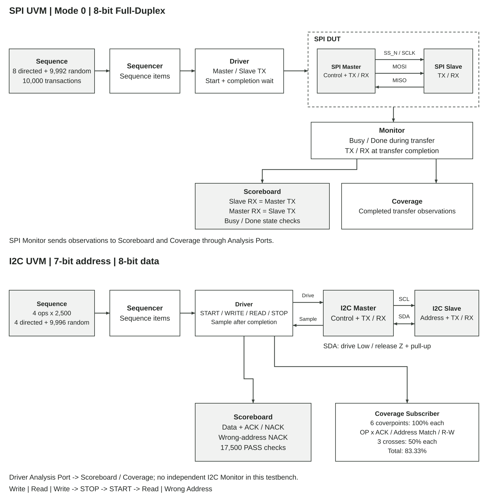

# SPI & I2C UVM Verification


SystemVerilog로 SPI/I2C RTL을 직접 설계하고, UVM 환경에서 자동 검증한 뒤 SPI를 Basys3 FPGA에서 실측한 프로젝트입니다.

## Highlights

| Area | Implementation |
|---|---|
| SPI RTL | 8-bit Mode 0 Master/Slave, full-duplex MOSI/MISO, programmable clock divider, loopback top |
| I2C RTL | START/STOP, Write/Read, ACK/NACK, address match, open-drain SDA |
| UVM | Sequence Item, Sequence, Sequencer, Driver, Monitor, Agent, Environment, Test, Factory, Config DB |
| Self-checking | Analysis Port/Imp, scoreboard PASS/FAIL, protocol status checks |
| Coverage | I2C operation, ACK/NACK, address match, R/W mode, data bins; operation × ACK / address match / R/W crosses |
| Hardware | Basys3 Master/Slave wrappers, button debounce, LED/FND status, logic-analyzer validation |

## Architecture



The UVM test creates transactions through a sequencer/driver path. **SPI** uses a monitor to reconstruct completed transfers and send them to scoreboard and coverage. In the **I2C testbench used for the 10,000-transaction run**, the driver samples DUT results after the command sequence and sends them through an analysis port to scoreboard and coverage. This is completion-state sampling, not independent bus-level monitoring.

## Verification Scenarios

| Target | Stimulus | Automated Checks |
|---|---|---|
| SPI directed | 8 pattern pairs: `AA/11`, `55/22`, `00/33`, `FF/44`, `0F/55`, `F0/66`, `A5/77`, `5A/88` | MOSI/MISO data integrity and Master/Slave busy/done state |
| SPI random | **9,992 randomized Master/Slave byte pairs** | Full-duplex receive data against both transmitted bytes |
| I2C write | 1 directed case + 2,499 randomized cases = **2,500 transactions** | Write ACK and Slave receive data |
| I2C read | 1 directed case + 2,499 randomized cases = **2,500 transactions** | Master receive data and final NACK |
| I2C write-read | 1 directed case + 2,499 randomized cases = **2,500 transactions** | Write/read data checks; STOP then START (not repeated START) |
| I2C wrong address | 1 directed case + 2,499 randomized cases = **2,500 transactions** | Address mismatch and NACK |

## Results

**2026-10-19 ~ 2026-10-20 extended UVM regression** — Synopsys VCS W-2024.09-SP2 / UVM 1.2, random seed `1234`:

| Target | Transactions | Scoreboard PASS checks | FAIL | Functional coverage |
|---|---:|---:|---:|---:|
| SPI Mode 0 | **10,000** (8 directed + 9,992 random) | **10,000** | **0** | Defined in source; numeric result not retained here |
| I2C | **10,000** (4 operations × 2,500) | **17,500** | **0** | **83.33%** |

Both supplied simulator report summaries recorded **UVM_ERROR: 0, UVM_FATAL: 0**. SPI checks a completed full-duplex transfer once per transaction; I2C checks two conditions for Write, Read, and Write-Read and one for Wrong Address, producing 17,500 individual PASS checks from 10,000 transactions. **PASS check count is not the number of distinct scenarios.**

I2C coverpoint metrics for operation, ACK/NACK, address match, R/W mode, and data were each 100%. Three defined crosses (operation × ACK, address match, R/W) each reached **50%**, contributing to the 83.33% aggregate. This percentage describes **only defined coverage bins**, not total I2C protocol coverage. Cross gaps remain outside this round's scope.

**Historical submitted results (2026-06):** SPI **38 PASS / 0 FAIL**, I2C **7 PASS / 0 FAIL** (7 I2C check assertions across four directed transactions). These historical counts are retained for comparison.

**Evidence and reproducibility:** Regression results above were read from VCS logs supplied during the October 2026 verification session; the raw `spi_10k.log` and `i2c_10k.log` files are kept on the user's Linux server and **are not included in this repository**. The checked-in SV sources reflect the tested version. GitHub Actions performs elaboration checks, **not these UVM runs**. Basys3 SPI timing was also checked separately using a logic analyzer.

## Troubleshooting Applied

- Stabilized FPGA SPI decoding by changing the board clock divider from `8'd4` to `8'd100`.
- Fixed the first MISO-bit timing by presenting `tx_data[7]` immediately when `SS_N` falls.
- Implemented I2C SDA as open drain: logic `1` releases the line to `Z`; logic `0` drives it low.
- Delayed SPI monitor sampling by `#1` after the start edge to observe RTL nonblocking-assignment updates correctly.

## Repository Structure

```text
.
├── rtl
│   ├── spi          # SPI Master, Slave and simulation loopback
│   └── i2c          # I2C Master, Slave and connected top
├── fpga             # Basys3 demo wrappers, control IP and FND display
├── tb               # SPI and I2C UVM testbenches
├── sim              # Compile-order file lists
└── assets           # Portfolio architecture diagram
```

## Run

From `uvm-spi-i2c-verification/` on a machine with VCS/UVM 1.2, compile the checked-in sources and run each regression separately:

```bash
vcs -full64 -sverilog -timescale=1ns/1ps -ntb_opts uvm-1.2 \
  -f sim/spi.f -top tb_top_spi_loopback -debug_access+all \
  -o simv_spi_10k -l compile_spi_10k.log
./simv_spi_10k +ntb_random_seed=1234 > spi_10k.log 2>&1

vcs -full64 -sverilog -timescale=1ns/1ps -ntb_opts uvm-1.2 \
  -f sim/i2c.f -top tb_top -debug_access+all \
  -o simv_i2c_10k -l compile_i2c_10k.log
./simv_i2c_10k +ntb_random_seed=1234 > i2c_10k.log 2>&1
```

The SV testbenches gate FSDB generation on `+DUMP_FSDB`, so the commands above do not request waveform dumps. If enabled, the setup needs compatible Verdi FSDB PLI. Simulator/version/tool licensing may affect reproducibility. Review the final Scoreboard and UVM report summaries; do not treat successful compilation as proof of PASS.

## Current Scope

- SPI is limited to one Master, one Slave and Mode 0.
- I2C does not yet cover multi-master arbitration, clock stretching, multiple Slaves or external sensors.
- Next verification steps are SVA protocol properties, code coverage, coverage closure, SPI CPOL/CPHA modes and I2C repeated START.


