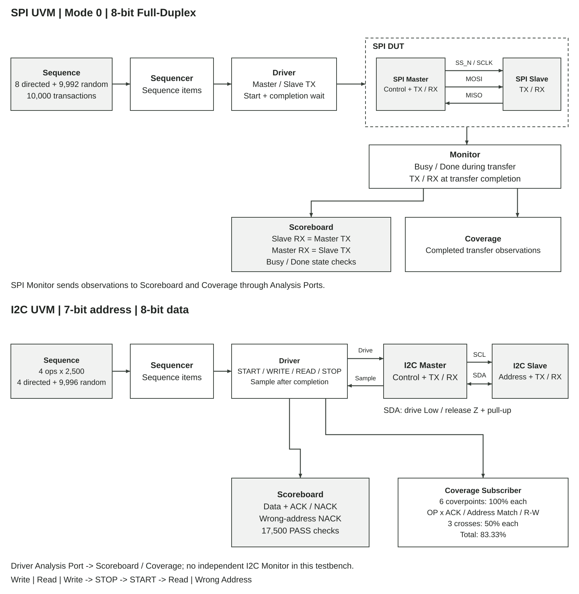

# SPI · I2C UVM Verification

SPI·I2C RTL과 UVM 검증 환경을 구현해 각각 10,000건을 시험하고, SPI 파형을 Basys3에서 확인했습니다.


[개요](#개요) · [담당 역할](#담당-역할) · [설계·구현](#설계구현) · [검증 결과](#검증-결과) · [실행 방법](#실행-방법)

## 개요

| 항목 | 내용 |
|---|---|
| 기술 | SystemVerilog · UVM 1.2 · VCS · Verdi · Basys3 |
| 검증 조건 | 2026.10.19–20 · VCS W-2024.09-SP2 · seed 1234 |


## 담당 역할

- SPI Mode 0 Master/Slave와 I2C Master/Slave RTL 구현
- UVM Sequence·Driver·Scoreboard·Coverage 구성, SPI Monitor와 I2C 완료 시점 샘플링 구현
- 정상·오류 트랜잭션 자동 비교와 SPI FPGA 파형 확인


## 설계·구현

<a id="highlights"></a>

### 구현 항목

| Area | Implementation |
|---|---|
| SPI RTL | 8-bit Mode 0 Master/Slave, full-duplex MOSI/MISO, programmable clock divider, loopback top |
| I2C RTL | START/STOP, Write/Read, ACK/NACK, address match, open-drain SDA |
| UVM | Sequence Item, Sequence, Sequencer, Driver, Monitor, Agent, Environment, Test, Factory, Config DB |
| Self-checking | Analysis Port/Imp, scoreboard PASS/FAIL, protocol status checks |
| Coverage | I2C operation, ACK/NACK, address match, R/W mode, data bins; operation × ACK / address match / R/W crosses |
| Hardware | Basys3 Master/Slave wrappers, button debounce, LED/FND status, logic-analyzer validation |

<a id="architecture"></a>

### 검증 환경 구조



Sequence가 만든 트랜잭션을 Sequencer·Driver를 통해 DUT에 전달합니다. SPI Monitor는 완료된 전송을 수집하고, I2C Driver는 명령 완료 시점의 DUT 상태·데이터를 수집합니다. 각 결과는 Analysis Port를 통해 Scoreboard와 Coverage로 전달합니다.


## 검증 결과

<a id="verification-scenarios"></a>

### 검증 시나리오

| Target | Stimulus | Automated Checks |
|---|---|---|
| SPI directed | 8 pattern pairs: `AA/11`, `55/22`, `00/33`, `FF/44`, `0F/55`, `F0/66`, `A5/77`, `5A/88` | MOSI/MISO data integrity and Master/Slave busy/done state |
| SPI random | **9,992 randomized Master/Slave byte pairs** | Full-duplex receive data against both transmitted bytes |
| I2C write | 1 directed case + 2,499 randomized cases = **2,500 transactions** | Write ACK and Slave receive data |
| I2C read | 1 directed case + 2,499 randomized cases = **2,500 transactions** | Master receive data and final NACK |
| I2C write-read | 1 directed case + 2,499 randomized cases = **2,500 transactions** | Write/read data checks; STOP then START (not repeated START) |
| I2C wrong address | 1 directed case + 2,499 randomized cases = **2,500 transactions** | Address mismatch and NACK |

<a id="results"></a>

### 검증 요약

**SPI·I2C 자동 검증**

검증 조건 · 2026.10.19–20 · Synopsys VCS W-2024.09-SP2 · UVM 1.2 · random seed `1234`

| Target | Transactions | Scoreboard PASS checks | FAIL | Functional coverage |
|---|---:|---:|---:|---:|
| SPI Mode 0 | **10,000** (8 directed + 9,992 random) | **10,000** | **0** | 코드에 정의 · 수치 미기재 |
| I2C | **10,000** (4 operations × 2,500) | **17,500** | **0** | **83.33%** |

SPI·I2C 시뮬레이션 결과는 모두 **UVM_ERROR: 0, UVM_FATAL: 0**입니다. SPI는 트랜잭션마다 완료된 양방향 전송을 한 번 검사합니다. I2C는 Write·Read·Write-Read에서 각각 두 항목, Wrong Address에서 한 항목을 검사해 10,000건의 트랜잭션에서 총 17,500개 PASS를 확인했습니다. **PASS 검사 수와 서로 다른 시나리오 수는 구분합니다.**

I2C의 동작 종류, ACK/NACK, 주소 일치, R/W 모드와 데이터 Coverpoint는 각각 100%입니다. 정의한 Cross 3개(Operation × ACK, 주소 일치, R/W)는 각각 **50%**이며, 전체 Functional Coverage는 83.33%입니다. Coverage는 정의한 Bin을 기준으로 집계했습니다. 잘못된 주소 Read와 Write-Read의 중간 Write 관찰은 미검증 조건으로 남았습니다.

<details>
<summary>2026.06 검증 결과</summary>

SPI **38 PASS / 0 FAIL**, I2C **7 PASS / 0 FAIL**입니다. I2C는 Directed Transaction 4건에서 7개 항목을 검사했습니다.

</details>

**실행 자료:** VCS 원본 로그 `spi_10k.log`·`i2c_10k.log`는 별도 보관하며 저장소에는 포함하지 않았습니다. GitHub Actions에서는 DUT elaboration을 검사합니다. UVM 검증은 아래 VCS 명령으로 실행하며, Basys3의 SPI 파형은 Logic Analyzer로 확인했습니다.

<a id="troubleshooting-applied"></a>

### 문제 해결

- 보드의 SPI Clock Divider를 `8'd4`에서 `8'd100`으로 바꾼 뒤 Logic Analyzer의 파형과 Decode를 확인했습니다.
- `SS_N`이 하강하면 `tx_data[7]`을 먼저 출력해 첫 SCLK 상승 에지 전에 MISO의 첫 비트를 준비했습니다.
- I2C SDA는 Open-Drain으로 구현했습니다. 논리 `1`에서는 선을 `Z`로 해제하고, 논리 `0`에서는 Low를 구동합니다.

#### Monitor의 Busy 관찰 시점 수정

Start 직후 Monitor가 RTL의 갱신 전 Busy 값을 읽는 현상을 확인했습니다. Start 입력, Nonblocking Assignment에 의한 상태 갱신, Monitor의 관찰 시점을 나눠 확인했습니다. SPI Monitor가 Start를 감지한 뒤 `#1` Sampling Delay를 두고 갱신한 상태를 읽게 수정했습니다. 송수신 데이터는 전송 완료 후 비교했습니다.


## 실행 방법

<a id="run"></a>

### VCS 실행

VCS/UVM 1.2 환경의 `uvm-spi-i2c-verification/` 폴더에서 다음 명령으로 SPI와 I2C를 각각 컴파일하고 실행합니다:

```bash
vcs -full64 -sverilog -timescale=1ns/1ps -ntb_opts uvm-1.2 \
  -f sim/spi.f -top tb_top_spi_loopback -debug_access+all \
  -o simv_spi_10k -l compile_spi_10k.log
./simv_spi_10k +ntb_random_seed=1234 > spi_10k.log 2>&1

vcs -full64 -sverilog -timescale=1ns/1ps -ntb_opts uvm-1.2 \
  -f sim/i2c.f -top tb_top -debug_access+all \
  -o simv_i2c_10k -l compile_i2c_10k.log
./simv_i2c_10k +ntb_random_seed=1234 > i2c_10k.log 2>&1
```

FSDB 파형은 `+DUMP_FSDB`를 지정할 때만 생성하므로 위 명령은 파형을 저장하지 않습니다. 파형을 저장하려면 호환되는 Verdi FSDB PLI 설정이 필요합니다. 실행 환경에는 시뮬레이터 버전과 라이선스 조건도 맞춰야 합니다. 컴파일 후에는 Scoreboard와 UVM 최종 요약에서 PASS/FAIL을 확인합니다.

### 검증 조건

- SPI 검증 범위는 Master 1개·Slave 1개와 Mode 0입니다.
- I2C의 다중 Master 중재, Clock Stretching, 여러 Slave 연결과 외부 센서는 검증 범위에 포함하지 않았습니다.
- SVA 프로토콜 속성, Code Coverage, SPI의 다른 CPOL/CPHA 모드와 I2C repeated START는 검증 범위에 포함하지 않았습니다.

<a id="repository-structure"></a>

### 디렉터리

```text
.
├── rtl
│   ├── spi          # SPI Master, Slave and simulation loopback
│   └── i2c          # I2C Master, Slave and connected top
├── fpga             # Basys3 demo wrappers, control IP and FND display
├── tb               # SPI and I2C UVM testbenches
├── sim              # Compile-order file lists
└── assets           # Portfolio architecture diagram
```


---

[웹 포트폴리오](https://seungyeol-rtl-portfolio.azuretide33.chatgpt.site) · [GitHub 프로필](https://github.com/lsy49055089)

[논문](https://github.com/lsy49055089/Parallel-Decision-Tree-Hardware) · [RTL / FPGA Design](https://github.com/lsy49055089/RTL-Design-Projects) · [Design Verification](https://github.com/lsy49055089/RTL-Verification-Projects) · [Embedded Systems](https://github.com/lsy49055089/Embedded-Systems-Projects) · [AI / CV](https://github.com/lsy49055089/AI-Projects)
